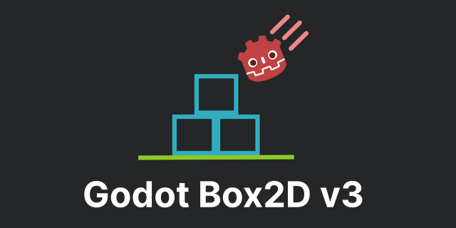

<p align="center">
  
</p>

Godot Box2D v3 is a high-performance physics extension for Godot 4.7+ that implements Box2D v3. It can be considered a successor to the [Godot Box2D](https://github.com/appsinacup/godot-box2d) extension.

It is a drop-in replacement for Godot Physics 2D. There is no engine fork and no new node types: the
existing `RigidBody2D`, `CharacterBody2D`, `Area2D` and joint nodes are all served by Box2D once the
extension is enabled.

## Features

- Improved stability and performance, especially for large piles of bodies
- Faster, more accurate queries (e.g. `cast_motion`, `intersect_ray`)
- Continuous collision detection (CCD) enabled by default for dynamic vs static collisions
- [Additional APIs](#additional-apis) to make the physics server easier and faster to use

## Requirements

- Godot 4.7 or later
- To build from source: Python 3 and [SCons](https://scons.org/)

## Installation

There are no binary releases yet, so build from source first (see below). A build leaves the
extension in `demo/bin/`, which is already the layout Godot expects:

```
demo/bin/
├── godot-box2d.gdextension
└── windows/
    └── godot-box2d.windows.template_debug.x86_64.dll
```

To use it in your own project:

1. Copy `demo/bin/` into your project. Godot scans the whole project tree for `.gdextension` files,
   so the folder can sit anywhere, but the library paths inside the manifest are relative to the
   manifest itself, so keep the folder intact.
2. Open the project. Godot loads the extension at startup.
3. In **Project Settings → Physics → 2D**, set **Physics Engine** to `Box2D`.
4. Restart the editor.

`physics/2d/physics_engine` is Godot's own setting. `Box2D` only appears in the dropdown once the
extension has loaded, which makes the dropdown a quick way to confirm the install worked.

## Building from source

The submodules are required and the build stops immediately without them.

```bash
git submodule update --init --recursive
scons target=template_debug platform=windows arch=x86_64
```

Set `platform` and `arch` to suit your machine: `windows`, `linux`, `macos`, `android`, `ios` or
`web`. Build products land in `bin/<platform>/` and are copied into `demo/bin/<platform>/`
automatically, so building also refreshes the demo project in place.

| Target | Use |
|---|---|
| `template_debug` | running in the editor, and debug exports |
| `template_release` | release exports |

**Build `template_debug`, not `target=editor`.** The manifest maps Godot's `.debug` feature tag to
the `template_debug` filenames, so an `editor` build produces a name that no manifest entry matches.
The extension then fails to load silently and physics falls back to Godot Physics.

Box2D itself is compiled from `thirdparty/box2d` into a static library as part of the same SCons
run, so there is no separate Box2D build step.

To build with the [Tracy](https://github.com/wolfpld/tracy) profiler:

```bash
scons target=template_debug tracy_enabled=yes
```

Options that you want to persist can go in a `custom.py` at the repository root instead of on the
command line.

Every push is built for Windows, Linux, macOS, Android, iOS and web by
`.github/workflows/builds.yml`. Those artifacts hold only the compiled libraries, so pair them with
`demo/bin/godot-box2d.gdextension` to get an installable folder.

## The demo project

`demo/` is an ordinary Godot project and doubles as the test suite, as there is no automated one.
Build first, then open `demo/` in Godot 4.7+; it already selects the Box2D server. Each root scene
exercises one subsystem:

| Scene | Covers |
|---|---|
| `Areas`, `Area Overrides` | sensors, gravity and damping overrides |
| `Body Properties` | mass, damping, body modes |
| `Character` | `CharacterBody2D` and `body_test_motion` |
| `Churn (Nodes)`, `Churn (Optimized)` | create and destroy throughput; the second drives the server directly through RIDs |
| `Contact Monitor` | contact reporting |
| `Joints` | every supported joint |
| `Queries` | ray, point, shape and motion casts |

## Project settings

Box2D specific settings live under `physics/box_2d/` in Project Settings. They are read once at
startup, so **changing one requires a restart**. See [docs/settings.md](docs/settings.md) for the
full table.

## Additional APIs

These sit on top of the standard `PhysicsServer2D` interface and are reached through the
`Box2DPhysicsServer2D` singleton, which exists only while the Box2D engine is active.

### `space_get_body_move_events(space) -> Array`

Returns every body that moved during the last step, as a flat array of
`[user_data, transform, user_data, transform, ...]`. This syncs a large number of bodies without a
callback or a node per body. Bodies whose user data was never set come back empty, so skip those.
Fails if called while the space is stepping.

### `body_set_user_data(body, data)` / `body_get_user_data(body) -> Variant`

Attaches an arbitrary value to a body. It is the value handed back by
`space_get_body_move_events`, so it is usually the index you want to write the transform into.

Together they drive thousands of bodies from a single `MultiMesh`:

```gdscript
func _physics_process(_delta: float) -> void:
    var events := Box2DPhysicsServer2D.space_get_body_move_events(get_world_2d().space)
    for i in range(0, events.size(), 2):
        var index = events[i]
        if index == null:
            continue
        multimesh.set_instance_transform_2d(index, events[i + 1])
```

See `demo/scripts/rain_spawner_optimized.gd` for the whole pattern, including creating the bodies
through RIDs.

### `cast_shape(parameters) -> Dictionary`

On `get_world_2d().direct_space_state`. Takes a `PhysicsShapeQueryParameters2D` and returns the
nearest hit along its motion, or an empty dictionary if there is none. Godot's `cast_motion` returns
only safe and unsafe fractions, so this saves a second query to find out what was actually hit and
where the shape ended up:

| Key | Meaning |
|---|---|
| `point` | contact point |
| `destination` | where the cast shape's origin comes to rest |
| `normal` | contact normal |
| `shape` | index of the shape that was hit |
| `rid` | RID of the collider |
| `collider_id` | instance id of the collider |
| `collider` | the collider object, present only when the instance id is valid |

### `cast_shape_all(parameters, max_results = 32) -> Array[Dictionary]`

The same, but returns every hit along the motion sorted by distance rather than just the nearest.

## Unsupported Features / Limitations

Most of the Physics API has been implemented, but the following features do not have parity with Godot Physics:

- `WorldBoundaryShape2D` unsupported (planned for a future version of Box2D)
- `SeparationRayShape2D` unsupported
- Space parameters (`space_set_param`) unsupported because Box2D v3 uses a different solver
- "Cast Ray" CCD mode (`CCDMode::CCD_MODE_CAST_RAY`) unsupported
- Contacts are not visible when `Visible Collision Shapes` is enabled
- Convex polygons cannot have more than 8 vertices (does not affect `CollisionPolygon2D`)
- `CharacterBody2D`: unstable movement on moving platforms
- One-way collision is decided from the contact normal, ignoring the one-way
  collision margin. A rigid body that ends up overlapping a one-way platform from above is pushed
  back out rather than allowed to continue through. Character movement (`CharacterBody2D`) still
  accounts for penetration depth and margin.
- The per-shape one-way collision direction Godot 4.7 supplies is ignored. The normal is still
  derived from the shape transform.
- Collision exceptions place the two bodies in the same simulation island, so they sleep and wake
  together, and adding one at runtime wakes both.
- Removing a collision exception between two bodies that are already overlapping and at rest does
  not push them apart. Collision resumes once either body moves.

## Planned Features

- [Cross-platform determinism](https://box2d.org/posts/2024/08/determinism/)
- Serialization + Rollback

## Credits

Originally created by Andrew Song ([Pizzaandy](https://github.com/Pizzaandy)).
